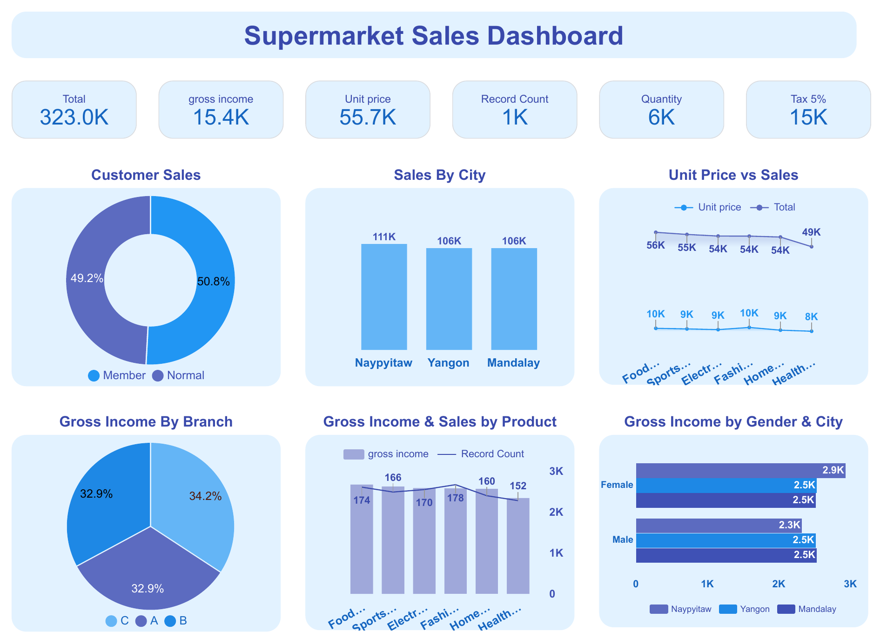

# Supermarket Sales Dashboard

A **Google Looker Studio** dashboard that analyses supermarket sales by customer type, city, branch, product line and gender.

## Key figures

| Measure | Value |
|---|---|
| Total sales | 323.0K |
| Gross income | 15.4K |
| Record count | 1K |
| Quantity | 6K |
| Tax 5% | 15K |

## Visuals

- **Customer Sales**: donut chart of members (50.8%) and normal customers (49.2%)
- **Sales By City**: bar chart (Naypyitaw 111K, Yangon 106K, Mandalay 106K)
- **Unit Price vs Sales**: line chart across six product lines
- **Gross Income By Branch**: pie chart (C 34.2%, A 32.9%, B 32.9%)
- **Gross Income & Sales by Product**: bars for gross income with a line for record count
- **Gross Income by Gender & City**: bar chart comparing female and male customers in each city

## Files in this repository

| File | Description |
|---|---|
| `Supermarket_Sales_Dashboard.pdf` | The dashboard exported from Looker Studio |
| `supermarket-sales-dashboard.png` | Picture of the dashboard |
| `index.html` | Project page for this repository |

## Built with

- Google Looker Studio

## Author

Created by **Sana Naik**, First Year Computer Engineering, Shri Anandrao Abitkar College of Engineering, Pal.
